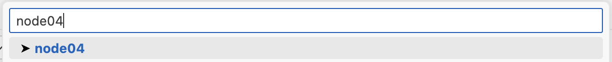

# Octopus GPU cluster

Octopus is a GPU cluster operated within the Faculty of Geosciences and Environment (FGSE). It has no job scheduler: users log in, pick a free node and run their jobs there, which makes it flexible but asks for some discipline. This page collects the basics to get started and to be a good neighbour.

::: info Questions and issues
The cluster has a dedicated channel on the Geocomputing Centre Discord server, where users help each other and announce reservations. Ask a member of your group or the Centre to add you. Current node reservations and the list of users are kept in an internal note shared there.
:::

## Getting access

Accounts are created on request. Ask your PI or research group lead, who will get in touch with the Geocomputing Centre. You will then receive an email with your username and a temporary password.

## Node configuration

In its current configuration the cluster has these node types:

| Nodes | Users | GPUs | GPU memory | CPUs | CPU cores | RAM |
|-------|-------|------|------------|------|-----------|-----|
| `node01`–`node26` | All | 4× Nvidia Titan X | 12 GB | 2× Intel Xeon E5 v3 | 6-core | 128 GB |
| `node27`–`node31` | ICE | 2× Nvidia RTX 4090 | 24 GB | 2× Intel Xeon E5 v3 | 6-core | 128 GB |
| `node32` | ICE + ∂AWN | 2× Nvidia RTX 6000 Pro | 96 GB | 2× Intel Xeon E5 v3 | 6-core | 128 GB |
| `node34` **Fat** | All | 1× Nvidia V100 PCIe | 16 GB | 2× Intel Xeon E5 v3 | 6-core | 1 TB |
| `node40` **DGX** | All | 8× Nvidia V100 SXM2 | 32 GB | 2× Intel Xeon Silver 4112 | 8-core | 756 GB |
| `node55` **CPU** | All | — | — | 2× Intel Xeon E5 v4 | 16-core | 512 GB |

::: warning Dedicated nodes
`node27`–`node31` (RTX 4090) are dedicated to the ICE group (Prof. Jouvet). `node32` (RTX 6000 Pro) is shared by two groups: **GPU 0 is for the ICE group, GPU 1 for the ∂AWN group (Prof. Beucler)**. Use the other group's GPU only when it is free and after asking them on Discord.
:::

## First login

1. If you work remotely, establish the VPN connection to UNIL first.
2. Log in once with the temporary password you received and change it:

   ```sh
   ssh <username>@octopus.unil.ch
   passwd
   ```

3. Enable password-less SSH: create an `ED25519` key pair and upload it to the cluster, for instance with `ssh-keygen` and `ssh-copy-id`. Look up how to set up password-less SSH for your platform if needed.
4. Add an entry to your `~/.ssh/config` (adapt the identity file name if yours differs):

   ```ssh-config
   Host octopus
     HostName octopus.unil.ch
     User <username>
     IdentityFile ~/.ssh/id_ed25519
   ```

5. `ssh octopus` should now land you on the login (master) node.

See [Advanced SSH config](#advanced-ssh-config) to reach compute nodes directly.

## General usage

### Work from the `work` partitions

You have access to `/home/<username>` and to `/work/<username>`, `/work2/<username>` or `/work3/<username>` (a link from your home to your work directory is usually created for you). **Data and all computations go to the `work` directories.** `home` is reserved for scripts and small items and is not a fast filesystem.

Never write results to `/tmp`: it is the node's small system disk, shared by everyone on that node, and files untouched for 10 days are deleted. This includes the scratch folders of AI coding assistants (`/tmp/claude-…`): tell them to write under `/work/<username>`.

### Never compute on the login node

Always `ssh` to a compute node before running anything. The login node is shared by everyone and overloading it slows down the whole cluster.

### Check that a node is free

There is no scheduler, so **it is the users' responsibility to monitor their jobs and to avoid interfering with other users' jobs**. A few tools help:

- `top` shows CPU and memory usage of all processes on a node. It does not show GPU usage, but it shows the host side of any GPU job and its process ID.
- `nvidia-smi` shows GPU utilisation and the processes running on the GPUs of the node. Its PIDs match the host-side PIDs in `top`. `watch -d -n 0.5 nvidia-smi` is handy to follow GPU usage.
- `htop` is a friendlier `top` with similar information.
- `/soft/bin/wwtop` shows the global cluster usage, utilisation and load per node. Inside `wwtop`, hit `x` to display GPU usage, and `o` then `G` to display the GPU driver version on each node.

::: tip Safe workflow
Look for empty or low-usage nodes with `wwtop`, then check CPU and host memory on that node with `top` or `htop`, and finally check GPU utilisation with `nvidia-smi`.
:::

## Keep a simulation running with `tmux`

`tmux` lets a session keep running on the server after you detach from it, and makes it much less likely to kill a run with a stray `Ctrl+c`. It is available on the cluster as `tmux`, and can also be installed in a conda environment with `conda install conda-forge::tmux`. `screen`, which is similar and native on the cluster, works too.

::: warning
If possible, run the tmux session **on a compute node** rather than on the login node, to avoid clogging the latter with extra processes.
:::

Start a session, optionally with a name:

```sh
tmux                      # unnamed session
tmux new -s <session_name>
```

Then start what you need, for instance activate your environment, `ssh` to a node and launch a long simulation. Detach with `Ctrl+b` then `d`. You can now disconnect and shut down your computer.

To come back, log in to octopus again, do not connect to a node, and attach:

```sh
tmux list-sessions          # which sessions are running
tmux attach                 # reattach the last one
tmux attach -t <session_name>
```

To end a session, attach to it and run `tmux kill-session`.

## VS Code over SSH

[VS Code](https://code.visualstudio.com) can connect to the cluster with the [Remote-SSH extension](https://code.visualstudio.com/docs/remote/ssh).

::: warning
This is convenient but can leave many processes running on the login node. Three habits avoid clogging it.
:::

1. **Work from a project folder, never from the filesystem root.** Open a specific project directory with "File → Open folder", avoiding `/work` or `/work2` themselves. This reduces the number of files VS Code watches. From a terminal on octopus you can also `cd` to the folder and run

   ```sh
   code -r .
   ```

   to restart VS Code in that directory.

2. **Unset "follow symlinks".** Open the preferences or the command palette, search for "symlink" and deactivate the option for the "Remote [SSH: octopus]" target.

   

3. **Kill and restart the VS Code server from time to time.** Open the command palette, type `kill vs code server` and apply it, then reconnect as usual.

   

### Advanced SSH config

A wildcard entry in your SSH config gives direct access to any compute node, using the password-less access to the login node as a proxy jump:

```ssh-config
Host node*
  HostName %h.octopoda
  User <username>
  ProxyJump octopus
```

Replace the username and adapt the proxy jump name to the host alias you chose in [First login](#first-login).

To open VS Code directly on a _free_ compute node, open the command palette and type `connect to host`:


The wildcard is not in the list, so type the node name yourself, for instance `node04`:



Hit enter, select `Linux` and accept the key fingerprint if asked. After the server setup you have VS Code running on the compute node.

::: info
Clean up when you leave the node by [killing the VS Code server there](#vs-code-over-ssh).
:::

## Python environments

### Anaconda

Python and conda are available through an Anaconda3 install under `/soft/anaconda3` (Anaconda3-2019.10, Python 3.7.4). The base environment includes `torch` and `torchvision`. `tensorflow` and `keras` are installed in the `tf-gpu` environment, which has not been tested.

To use it, source or add to your `.bashrc`:

```sh
# >>> conda initialize >>>
# !! Contents within this block are managed by 'conda init' !!
__conda_setup="$('/soft/anaconda3/bin/conda' 'shell.bash' 'hook' 2> /dev/null)"
if [ $? -eq 0 ]; then
    eval "$__conda_setup"
else
    if [ -f "/soft/anaconda3/etc/profile.d/conda.sh" ]; then
        . "/soft/anaconda3/etc/profile.d/conda.sh"
    else
        export PATH="/soft/anaconda3/bin:$PATH"
    fi
fi
unset __conda_setup
# <<< conda initialize <<<
```

### Micromamba

Another way to manage Python environments is `micromamba`, keeping the environments on the fast `work` filesystem:

1. Create the folder `/work/<username>/.micromamba`.
2. Run `/soft/micromamba/bin/micromamba shell init /work/<username>/.micromamba`.
3. Source your `.bashrc`.
4. Run `micromamba activate`.
5. Test the install by adding a package and checking that it lands in `/work/<username>/.micromamba`.

## Containers (Apptainer)

[Apptainer](https://apptainer.org) runs container images on `node27`–`node32` as your own user: nothing to request, and what you write belongs to you. Docker is not available on the cluster. Your home, `/work`, `/work2`, `/work3` and `/tmp` are visible inside a container.

Shared images are in `/soft/containers`:

| Image | Contents | GPUs it covers |
|-------|----------|----------------|
| `tf-25.02-tf2-py3.sif` | NVIDIA NGC TensorFlow 25.02: TensorFlow 2.17, CUDA 12.8, Python 3.12 | RTX 4090 (`node27`–`node31`) and RTX 6000 Pro (`node32`). Not Titan X or V100: keep conda there. |

Run a command inside an image with `--nv` for GPU access, and **always pick a GPU**: the container sees every GPU of the node, and TensorFlow would take memory on all of them.

```sh
CUDA_VISIBLE_DEVICES=0 apptainer exec --nv /soft/containers/tf-25.02-tf2-py3.sif python my_script.py
```

::: warning
Check `nvidia-smi` first and run one job per GPU. Write outputs under `/work*/<username>`, never `/tmp`. On large grids the first iterations take minutes while XLA compiles.
:::

### IGM with `igm-ngc`

`/soft/containers/igm-ngc` wraps the TensorFlow image for the [Instructed Glacier Model](https://github.com/instructed-glacier-model/igm). It installs your IGM clone into `~/.local-ngc` once (your conda environments are not touched), then runs any command inside the image. It refuses to start without `CUDA_VISIBLE_DEVICES`.

```sh
ssh node32
/soft/containers/igm-ngc install /work/$USER/igm       # once, about a minute; again if IGM's dependencies change
CUDA_VISIBLE_DEVICES=0 /soft/containers/igm-ngc info   # TensorFlow, CUDA and the GPU it sees
```

Launch a run from the login node in a named `tmux` session on the compute node, so you can log out and come back to it:

```sh
PROJECT=/work/$USER/my-project   # folder with experiment/ and your inputs
NAME=run01                       # tmux session and output folder
EXP=params                       # experiment/params.yaml
GPU=0                            # a free GPU on that node (nvidia-smi index)
ssh -n node32 "tmux new-session -d -s $NAME 'cd $PROJECT && mkdir -p outputs && CUDA_VISIBLE_DEVICES=$GPU TF_CPP_MIN_LOG_LEVEL=3 PYTHONUNBUFFERED=1 /soft/containers/igm-ngc igm_run +experiment=$EXP hydra.run.dir=outputs/$NAME > outputs/$NAME.log 2>&1'"
```

Hydra overrides go after `+experiment=$EXP`. On a 4090 node, replace `node32`. Then:

```sh
tail -f $PROJECT/outputs/$NAME.log       # follow
ssh node32 tmux ls                       # what is running
ssh node32 tmux kill-session -t $NAME    # stop
```

::: warning node32
Avoid adaptive patching combined with in-loop emulator retraining: each patch shape triggers a new compile, which has hung a run for hours. With 96 GB, large grids run unpatched.
:::

| You see | Do this |
|---------|---------|
| `igm-ngc: set CUDA_VISIBLE_DEVICES…` | Put `CUDA_VISIBLE_DEVICES=<gpu>` in front of the command. |
| `WARNING: GPU N already has … MiB in use` | Someone is on that GPU; choose a free one from `nvidia-smi`. |
| `igm not installed` or `igm_run: not found` | Run `igm-ngc install` on that account. |
| `apptainer is not installed on nodeNN` | Apptainer is on `node27`–`node32` only. |
| `NetCDF: Unknown file format` after a killed run | The file was truncated; delete it before relaunching. |

## Software and modules

Spack, modules and the installation of new software are not documented yet. Ask on Discord in the meantime. For containers, see [Containers (Apptainer)](#containers-apptainer).
